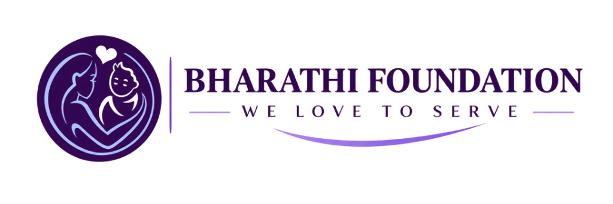
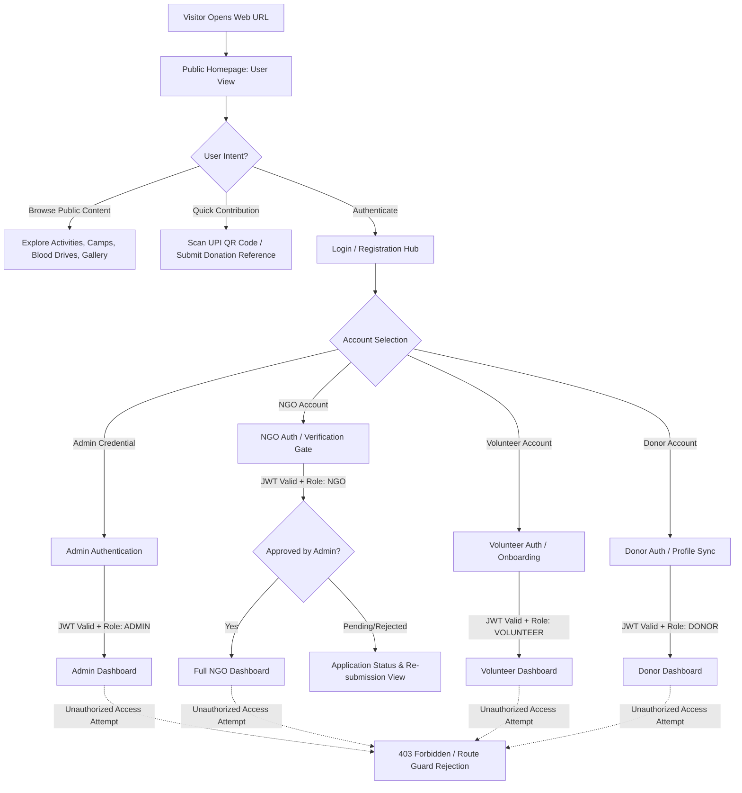
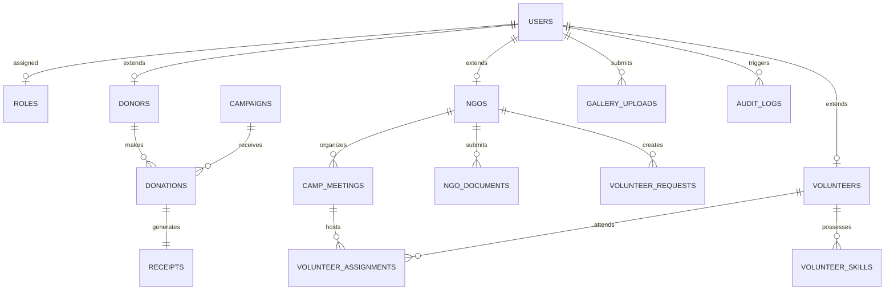
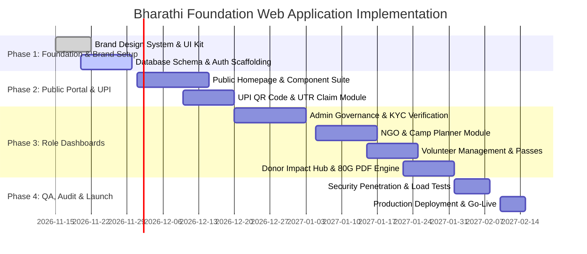

# SOFTWARE REQUIREMENTS SPECIFICATION (SRS)
## BHARATHI FOUNDATION – WE LOVE TO SERVE



---

### Document Control & Metadata

| Attribute | Details |
| :--- | :--- |
| **Project Title** | Bharathi Foundation Responsive Management & Public Engagement Web Application |
| **Document Version** | 1.0.0 (Production Release Specification) |
| **Document Status** | Approved for Architecture & Development |
| **Organization** | Bharathi Foundation |
| **Motto / Tagline** | *WE LOVE TO SERVE* |
| **Primary Authors** | Senior Business Analyst, Lead UI/UX Architect, Principal Solutions Architect |
| **Target Audience** | Engineering Leads, Full Stack Developers, UI/UX Designers, Foundation Executives |

---

## 1. Executive Summary & Project Overview

### 1.1 Mission & Vision
**Bharathi Foundation** is dedicated to holistic community empowerment through structured social welfare programs, including non-profit (NGO) support, grassroots volunteer mobilization, life-saving blood donation campaigns, remote medical and community camp meetings, and transparent financial stewardship. 

Guided by the motto **"WE LOVE TO SERVE"**, the foundation requires a centralized, scalable, modern web application that bridges compassionate donors, verified NGOs, energetic volunteers, and administrators into an integrated ecosystem.

### 1.2 Core System Objectives
1. **Unrestricted Public Engagement**: Provide a responsive, public-facing portal where visitors explore foundation achievements, ongoing camp meetings, blood donation campaigns, and verified photo galleries without mandatory authentication.
2. **Four Dedicated Role Dashboards**: Deliver four distinct, role-segregated control panels with strict role-based access control (RBAC):
   - **Admin Dashboard**: Comprehensive oversight, verification, content management, financial reconciliation, and analytics.
   - **NGO Dashboard**: Collaboration pipeline for registered organizations to organize camps, request volunteer manpower, and submit verified activity reports.
   - **Volunteer Dashboard**: Self-service portal for citizens to register, select causes matching their skills, track attendance, and log service hours.
   - **Donor Dashboard**: Transparent contribution hub featuring UPI QR donations, automated UTR verification requests, 80G tax-deductible receipts, and campaign impact tracking.
3. **Transparent Financial Giving**: Implement a direct UPI QR code and UPI ID contribution workflow with instant transaction acknowledgement, eliminating third-party aggregator overhead while maintaining auditability.
4. **Unified Identity & Role-Based Entry Routing**: A seamless sign-in portal that immediately routes users to their respective dashboards based on authenticated permissions.

---

## 2. Brand Identity & UI/UX Design System

The visual design system embodies compassion, nobility, safety, and operational transparency.

```
                      BRAND COLOR PALETTE
┌───────────────────────┬───────────────────────┬───────────────────────┐
│     Deep Purple       │       Lavender        │      Clean White      │
│  (Primary Brand)      │  (Secondary Accent)   │   (Canvas/Surface)    │
│       #2E0854         │       #A586C5         │       #FFFFFF         │
│  RGB(46, 8, 84)       │  RGB(165, 134, 197)   │  RGB(255, 255, 255)   │
└───────────────────────┴───────────────────────┴───────────────────────┘
```

### 2.1 Color Tokens & Theming

| Token Name | Hex Code | Purpose & Usage |
| :--- | :--- | :--- |
| `color-primary-900` | `#1F0438` | Deep Purple Dark: Headings, high-contrast text, master headers |
| `color-primary-700` | `#2E0854` | **Deep Purple (Brand Primary)**: Navbar, active tabs, primary CTA buttons |
| `color-primary-500` | `#4B1885` | Primary Hover state, icon accents, active indicators |
| `color-secondary-500` | `#A586C5` | **Lavender (Brand Secondary)**: Badges, borders, sub-headings, subtle chips |
| `color-secondary-200` | `#E8DFF5` | Lavender Light: Card backgrounds, focus rings, hover fills |
| `color-secondary-50` | `#F7F4FB` | Lavender Tint: Table alternating rows, section backgrounds |
| `color-surface` | `#FFFFFF` | **Pure White**: Primary page background, modal and card surfaces |
| `color-text-body` | `#2D3142` | Slate Charcoal: High-legibility body prose (WCAG AAA compliant) |
| `color-success` | `#10B981` | Emerald Green: Verified donor receipts, approved NGO status |
| `color-urgent-blood` | `#DC2626` | Crimson Red: Emergency blood donation banners and badge indicators |
| `color-warning` | `#F59E0B` | Amber: Pending verification states for NGOs and Volunteer applications |

### 2.2 Typography
- **Primary Body Font**: `Inter`, `-apple-system`, `sans-serif` (Optimal cross-device legibility for data-heavy dashboards).
- **Display & Heading Font**: `Plus Jakarta Sans` or `Outfit` (Modern, rounded warmth reflecting community service).
- **Brand Wordmark Font**: Stylized Serif / Trajan-inspired typeface reflecting the official logo wordmark (*"BHARATHI FOUNDATION – WE LOVE TO SERVE"*).

### 2.3 Logo Usage Guidelines
- The official Bharathi Foundation logo (symbolizing a mother embracing a child within a circular badge crowned with a heart) must be placed:
  1. **Public Navbar**: Left-aligned, vector-rendered SVG/High-Res PNG, height 56px with responsive scaling down to 42px on mobile devices.
  2. **Auth Views**: Centered prominently above login/registration forms (width 260px).
  3. **Role Dashboards**: Fixed at top-left of sidebar / header alongside the authenticated workspace name.
  4. **Official 80G Receipts**: Embedded at top-center of printable/downloadable donation receipts.
  5. **Footer**: Left column with the official tagline *"WE LOVE TO SERVE"*, non-profit registration numbers, and tax-exemption credentials.

---

## 3. Application Entry Flow & Navigation Architecture



### 3.1 Step 1: Public Homepage (User View)
The root URL (`/`) serves as the unrestricted public showcase. Zero authentication is required to browse programs, view emergency blood requests, verify upcoming medical camps, or scan the donation QR code.

### 3.2 Step 2: Role-Based Login & Unified Authentication
The authentication interface (`/auth/login`) provides an intuitive single-sign-on experience with clear role identification:
- **Direct Role Switcher or Auto-Detection**: Users can toggle between **Donor**, **Volunteer**, **NGO Partner**, and **Foundation Admin**, or sign in using their registered email/mobile where the backend automatically queries the verified role claim.
- **Dedicated Registration Pathways**:
  - `/auth/register/donor`: Name, mobile, email, PAN number (optional, for 80G receipt), password.
  - `/auth/register/volunteer`: Personal details, blood group, skills, available hours, city/pincode, identification document.
  - `/auth/register/ngo`: Organization legal name, Darpan/Registration ID, 12A/80G certs, contact person details, official address.

### 3.3 Step 3: Role-Based Dashboard Redirection & Security Boundary
Upon successful authentication, the API returns a signed JWT stored inside an `HttpOnly`, `SameSite=Strict`, `Secure` cookie along with the user's role payload. The client application router triggers an immediate redirection matrix:

| User Role | Assigned Redirect Route | Route Protection Middleware Rule |
| :--- | :--- | :--- |
| **System Administrator** | `/admin/dashboard` | `role === 'SUPER_ADMIN' \|\| role === 'ADMIN'` |
| **Registered NGO** | `/ngo/dashboard` | `role === 'NGO'` (With status check: `APPROVED` vs `PENDING`) |
| **Active Volunteer** | `/volunteer/dashboard` | `role === 'VOLUNTEER'` |
| **Financial Donor** | `/donor/dashboard` | `role === 'DONOR'` |

---

## 4. Public Homepage Specifications (User View)

```
┌────────────────────────────────────────────────────────────────────────┐
│ [LOGO] BHARATHI FOUNDATION    Home  About  Camps  Blood  Gallery [DONATE] [LOGIN] │
├────────────────────────────────────────────────────────────────────────┤
│                                                                        │
│                      "WE LOVE TO SERVE"                                │
│   Empowering Communities • Saving Lives • Inspiring Human Hope         │
│   [ Join as Volunteer ]            [ Quick UPI Donate ]                │
│                                                                        │
├──────────────────┬──────────────────┬──────────────────┬───────────────┤
│  50+ Camps Held  │  1,200+ Donors   │  3,500+ Lives    │ 15+ Partner   │
│                  │                  │    Impacted      │     NGOs      │
├──────────────────┴──────────────────┴──────────────────┴───────────────┤
│  • Blood Donation Emergency Alert Feed                                  │
│  • Upcoming Free Medical & Diagnostic Camps Schedule                   │
│  • NGO Collaborative Initiatives                                       │
│  • Verified Photo & Video Gallery                                      │
│  • Instant UPI QR Code Section (Scan & Give)                           │
└────────────────────────────────────────────────────────────────────────┘
```

### 4.1 Section-by-Section Functional Details

#### 1. Header & Navigation Bar
- **Sticky Navbar**: Stays anchored at top with a subtle backdrop blur (`backdrop-blur-md bg-white/90`).
- **Brand Unit**: High-resolution Bharathi Foundation Logo + Wordmark + Tagline.
- **Nav Links**: Home, About Us, Core Services, NGO Initiatives, Blood Drives, Camp Meetings, Gallery, Contact.
- **Action CTAs**: 
  - `Donate Now` (Vibrant Deep Purple button with subtle pulse animation).
  - `Login / Register` (Clean Lavender-accented outline button with dropdown selector).

#### 2. Hero Section
- **Emotional Headline**: *"Serving Humanity with Compassion, Dignity, and Dedication."*
- **Sub-tagline**: Official motto: *"WE LOVE TO SERVE"*.
- **Interactive Action Buttons**: 
  - Primary: `Join as a Volunteer` (leads to registration).
  - Secondary: `Scan & Donate (UPI)` (smooth scrolls to donation module).
- **Live Counter Band**: Real-time stats pulled from backend:
  - *Active Blood Donors Registered*
  - *Medical Camps Completed*
  - *Partner NGOs Supported*
  - *Lives Uplifted*

#### 3. About Bharathi Foundation
- Narrative detailing founding principles, legal non-profit status, transparency guarantees, and core values: Empathy, Integrity, Action, and Community First.
- Founder & Leadership message with verified credentials.

#### 4. Core Services & Focus Areas
Card grid featuring hover interactions:
1. **Health & Medical Outreach**: Free diagnostic check-ups, doctor consultations, medicine distribution.
2. **Voluntary Blood Donation Drives**: Emergency blood donor matching and institutional camp drives.
3. **Child Welfare & Educational Aid**: School kits, nutritional support, and literacy drives.
4. **Disaster & Emergency Relief**: Rapid deployment of food, clothing, and clean water in crisis areas.
5. **Elder Care & Dignity Support**: Assistance programs for vulnerable senior citizens.

#### 5. NGO Collaborative Activities
- Showcase of collaborative projects run in partnership with grassroots NGOs.
- Filters by cause: Child Welfare, Women Empowerment, Healthcare, Sanitation.
- Callout banner: *"Are you a registered NGO? Partner with Bharathi Foundation to scale your impact. [Apply for NGO Affiliation]"*.

#### 6. Emergency Blood Donation Campaigns Section
- **Real-Time Blood Need Ticker**: Highlights urgent blood group requirements (e.g., `Urgent: O- Negative needed at City Civil Hospital`).
- **Searchable Camp Calendar**: Displays upcoming blood donation drives with date, venue, Google Maps link, and expected turnout.
- **Quick Registration**: One-click form for donors to register for an upcoming camp.

#### 7. Camp Meetings & Community Outreach Schedule
- Tabbed schedule view: *Upcoming Camps*, *Ongoing Camps*, *Past Camp Reports*.
- Displays Camp Type (Pediatric, Eye Care, General Medicine, Blood Donation), Lead Partner NGO, Venue, Time, and Free Services Offered.

#### 8. Verified Photo & Video Gallery
- Responsive Masonry Grid of high-resolution images from foundation events.
- Category filters: *All*, *Blood Camps*, *Rural Outreach*, *Food Drives*, *Celebrations*.
- Lightbox popup modal with event date, location, and caption description.

#### 9. Instant Public UPI Donation Section
- **Prominent Display**: High-definition, dynamically generated UPI QR Code branded with Bharathi Foundation's legal account name.
- **Official UPI ID**: One-click `Copy UPI ID` button (`bharathifoundation@upi`).
- **Interactive Quick Reference Submission Form**:
  - Allows public donors who scanned the QR code to immediately input their Name, Phone, Email, Amount, and UPI UTR / Transaction Reference Number to receive an instant SMS/Email acknowledgement and tax receipt.
- **80G Tax Exemption Badge**: Highlights eligibility under Section 80G of the Income Tax Act.

#### 10. Contact & Community Helpdesk
- Address, phone numbers, emergency blood helpline, email contacts.
- Interactive contact inquiry form with reCAPTCHA v3 protection.
- Embedded Google Maps locator.

#### 11. Footer
- Full brand signature with logo, legal disclaimers, Section 12A/80G registration numbers.
- Quick navigation sitemap.
- Newsletter signup.
- Social media links (Instagram, Facebook, LinkedIn, YouTube, X).
- Copyright Notice: *© 2026 Bharathi Foundation. All Rights Reserved. WE LOVE TO SERVE.*

---

## 5. Detailed Dashboard Specifications

---

### 5.1 Admin Dashboard (`/admin/dashboard`)

The Admin Dashboard provides complete governance over operations, finances, content, and personnel.

#### Functional Modules:
1. **Executive Analytics & KPI Dashboard**:
   - Total funds raised (Monthly, Quarterly, All-time) split by campaign.
   - Pending verification counters (Unverified NGOs, Volunteer applicants, Unverified UPI UTR references).
   - Live blood group inventory / emergency request fulfillment rates.
2. **NGO Governance**:
   - Master list with search, filter (Pending, Approved, Rejected, Suspended).
   - Document inspection viewer: View uploaded 12A, 80G, NGO Darpan IDs, PAN cards, and Trustee IDs in-browser.
   - 1-click Approval or Rejection (with mandatory reason prompt sent via email).
3. **Volunteer Management**:
   - Complete directory of volunteers with skills, availability, and total hours served.
   - Assign volunteers to specific NGO activities or blood donation camps.
   - Issue digitally signed Certificates of Appreciation.
4. **Donor & Financial Stewardship**:
   - Real-time ledger of all incoming donation claims.
   - **UTR Reconciliation Console**: Cross-check donor-submitted UTR against bank statements; mark as `Verified`, `Disputed`, or `Refunded`.
   - **UPI Configuration Settings**: Upload or replace the official UPI QR code image and update the active UPI VPA address.
   - Automated 80G tax receipt batch generator and email dispatcher.
5. **Camp Meetings & Blood Drive Management**:
   - Create, edit, and publish upcoming medical camps and blood drives.
   - Assign nodal officers, allocate volunteer slots, and set target beneficiary quotas.
   - Export attendee lists and medical partner records.
6. **Website Content Management System (CMS)**:
   - Dynamic photo gallery upload, image compression, tagging, and deletion.
   - News, announcements, and emergency blood ticker banner manager.
7. **System Audit Logs & Role Administration**:
   - Detailed immutable audit trail of every administrative action (timestamp, user ID, IP address, changed fields).

---

### 5.2 NGO Dashboard (`/ngo/dashboard`)

Dedicated portal for accredited non-governmental organizations to collaborate with Bharathi Foundation.

#### Functional Modules:
1. **Registration & Compliance Onboarding**:
   - Step-by-step registration wizard with file upload for legal accreditation (Registration Certificate, Trust Deed, 80G/12A, Darpan Portal ID).
   - Real-time compliance status banner (`Pending Review`, `Verified & Active`, `Action Required`).
2. **Organization Profile Management**:
   - Edit organization bio, mission statement, contact person, social links, and official logo.
3. **Activity & Project Creation**:
   - Propose welfare initiatives under Bharathi Foundation endorsement.
   - Define objectives, target demographic, budget estimate, and execution timeline.
4. **Camp Meeting Organizer**:
   - Plan and schedule community medical camps, eye-testing camps, or food drives.
   - Set venue logistics, required doctor specializations, and safety measures.
5. **Volunteer Requisition System**:
   - Post volunteer requirement requisitions (e.g., *"Need 15 volunteers for registration and crowd control at Community Hall"*).
   - View assigned volunteers, verify their contact details, and record their attendance post-event.
6. **Post-Event Impact Reporting & Media Upload**:
   - Submit mandatory event completion reports (Total beneficiaries served, doctors attended, supplies distributed).
   - Upload high-resolution event photographs for Admin approval to be featured in the public gallery.
7. **Allocated Fund & Campaign Viewer**:
   - View donation sums specifically raised for the NGO's co-sponsored campaigns.

---

### 5.3 Volunteer Dashboard (`/volunteer/dashboard`)

Focused on empowering individual volunteers to discover opportunities, track service hours, and participate in foundation activities.

#### Functional Modules:
1. **Volunteer Profile & Skills Matrix**:
   - Personal info, blood group, emergency contact, t-shirt size for drives.
   - Select skills (First Aid, Crowd Management, Photography, Logistics, Data Entry, Counseling).
   - Specify availability (Weekends only, Full-time, On-call emergencies).
2. **Opportunity Discovery Feed**:
   - Searchable, filterable list of upcoming NGO activities, blood drives, and camp meetings.
   - One-click registration for event participation.
3. **My Schedule & Digital Attendance Pass**:
   - View confirmed upcoming service commitments.
   - Generates an event-specific QR code used by NGO leads to scan and record check-in/check-out.
4. **Service History & Hours Log**:
   - Detailed ledger of all events attended with validated volunteer hours.
   - Download verifiable digital PDF Certificates of Appreciation.
5. **Activity Photo Contribution**:
   - Volunteers can upload ground photos taken during camps directly to the admin queue.
6. **Emergency Blood Donor Broadcast Alerts**:
   - Receive instant push/SMS notifications when a patient matching the volunteer's blood group urgently needs blood nearby.

---

### 5.4 Donor Dashboard (`/donor/dashboard`)

A secure, donor-centric environment providing complete visibility over financial contributions, tax receipts, and direct social impact.

#### Functional Modules:
1. **Donor Profile & Tax Settings**:
   - Manage donor name, phone, email, and PAN Card Number (Permanent Account Number for legal 80G tax exemptions).
   - Toggle anonymity (Display name on public donor roll vs. remain anonymous).
2. **Integrated UPI Donation Console**:
   - Real-time display of official Bharathi Foundation UPI QR Code.
   - Deep-link support for mobile users: clicking "Pay with UPI" opens installed UPI apps (GPay, PhonePe, Paytm, BHIM) with pre-filled foundation VPA.
3. **Transaction Submission & Verification**:
   - Donor submits payment claim: Amount, Date, Time, Bank Reference / UTR (Unique Transaction Reference) number, and optional payment screenshot.
   - Live status tracker: `Submitted` ➔ `Under Verification` ➔ `Payment Verified & Receipt Ready`.
4. **Automated 80G Tax Exemption Receipt Archive**:
   - Instant PDF download of official donation receipts compliant with Section 80G of the Indian Income Tax Act.
   - Receipts include Foundation 80G approval number, donor PAN, transaction UTR, digital signature, and Bharathi Foundation official seal.
5. **Campaign Impact Transparency**:
   - Donors see visual breakdowns of how their contributions funded medical kits, blood camp refrigeration units, school supplies, or patient surgeries.

---

## 6. Non-Functional & Security Requirements

### 6.1 Security & Access Control
- **Role-Based Access Control (RBAC)**: Enforced via cryptographic JSON Web Tokens (JWT) stored in `HttpOnly`, `SameSite=Lax/Strict`, `Secure` cookies.
- **Password Security**: Passwords hashed using Argon2id or Bcrypt (work factor 12+).
- **Data Protection & Privacy**: 
  - Donor PAN and phone numbers masked in general listings.
  - Blood donor health history stored with encrypted attributes (AES-256-GCM).
- **CSRF & XSS Mitigation**: Content Security Policy (CSP) headers enabled, cross-origin resource sharing (CORS) restricted to authorized domains, sanitization of all user-generated inputs.
- **Rate Limiting**: IP-based rate limiting on authentication endpoints (maximum 5 failed attempts per 15 minutes) and public contact forms (maximum 3 submissions per 10 minutes).

### 6.2 Performance & Scalability
- **Page Load Time**: First Contentful Paint (FCP) < 1.2s; Largest Contentful Paint (LCP) < 2.0s on standard 4G networks.
- **Image Optimization**: Automatic conversion of uploaded photos to WebP / AVIF with adaptive responsive srcset generation.
- **High Concurrency Handling**: Public homepage cached via CDN Edge servers capable of sustaining 10,000+ simultaneous requests during viral campaigns.

### 6.3 Accessibility & Mobile Responsiveness
- **Compliance**: Full compliance with WCAG 2.1 Level AA standards.
- **Contrast Ratios**: Minimum contrast ratio of 4.5:1 for all text elements against Deep Purple or Lavender accents.
- **Responsive Breakpoints**:
  - Mobile: `320px` to `640px`
  - Tablet: `641px` to `1024px`
  - Desktop: `1025px` to `1920px` and above

---

## 7. Data Architecture & Entity-Relationship Model



### 7.1 Database Schema Definition (PostgreSQL DDL Reference)

```sql
-- Role Enumeration
CREATE TYPE user_role AS ENUM ('SUPER_ADMIN', 'ADMIN', 'NGO', 'VOLUNTEER', 'DONOR');
CREATE TYPE verification_status AS ENUM ('PENDING', 'APPROVED', 'REJECTED', 'SUSPENDED');
CREATE TYPE donation_status AS ENUM ('CLAIMED', 'VERIFIED', 'DISPUTED', 'CANCELLED');

-- Core Users Table
CREATE TABLE users (
    id UUID PRIMARY KEY DEFAULT gen_random_uuid(),
    email VARCHAR(255) UNIQUE NOT NULL,
    phone VARCHAR(20) UNIQUE NOT NULL,
    password_hash VARCHAR(255) NOT NULL,
    full_name VARCHAR(255) NOT NULL,
    role user_role NOT NULL,
    is_active BOOLEAN DEFAULT TRUE,
    created_at TIMESTAMP WITH TIME ZONE DEFAULT CURRENT_TIMESTAMP,
    updated_at TIMESTAMP WITH TIME ZONE DEFAULT CURRENT_TIMESTAMP
);

-- NGO Entity Extension
CREATE TABLE ngos (
    id UUID PRIMARY KEY DEFAULT gen_random_uuid(),
    user_id UUID REFERENCES users(id) ON DELETE CASCADE,
    organization_name VARCHAR(255) NOT NULL,
    darpan_id VARCHAR(100),
    registration_number VARCHAR(100) NOT NULL,
    founded_year INT,
    official_address TEXT NOT NULL,
    website_url VARCHAR(255),
    verification_status verification_status DEFAULT 'PENDING',
    rejection_reason TEXT,
    created_at TIMESTAMP WITH TIME ZONE DEFAULT CURRENT_TIMESTAMP
);

-- Volunteer Entity Extension
CREATE TABLE volunteers (
    id UUID PRIMARY KEY DEFAULT gen_random_uuid(),
    user_id UUID REFERENCES users(id) ON DELETE CASCADE,
    blood_group VARCHAR(10) NOT NULL,
    emergency_contact VARCHAR(20) NOT NULL,
    city VARCHAR(100) NOT NULL,
    pincode VARCHAR(10) NOT NULL,
    id_proof_url VARCHAR(500),
    verification_status verification_status DEFAULT 'APPROVED',
    total_hours_served INT DEFAULT 0,
    created_at TIMESTAMP WITH TIME ZONE DEFAULT CURRENT_TIMESTAMP
);

-- Donor Entity Extension
CREATE TABLE donors (
    id UUID PRIMARY KEY DEFAULT gen_random_uuid(),
    user_id UUID REFERENCES users(id) ON DELETE CASCADE,
    pan_number VARCHAR(10),
    is_anonymous BOOLEAN DEFAULT FALSE,
    address TEXT,
    created_at TIMESTAMP WITH TIME ZONE DEFAULT CURRENT_TIMESTAMP
);

-- Donations & UPI Financial Ledger
CREATE TABLE donations (
    id UUID PRIMARY KEY DEFAULT gen_random_uuid(),
    donor_id UUID REFERENCES donors(id) ON DELETE SET NULL,
    donor_name VARCHAR(255) NOT NULL,
    donor_email VARCHAR(255) NOT NULL,
    donor_phone VARCHAR(20) NOT NULL,
    donor_pan VARCHAR(10),
    amount NUMERIC(12, 2) NOT NULL,
    utr_reference VARCHAR(100) UNIQUE NOT NULL,
    payment_method VARCHAR(50) DEFAULT 'UPI',
    status donation_status DEFAULT 'CLAIMED',
    verified_by UUID REFERENCES users(id),
    verified_at TIMESTAMP WITH TIME ZONE,
    campaign_id UUID,
    screenshot_url VARCHAR(500),
    created_at TIMESTAMP WITH TIME ZONE DEFAULT CURRENT_TIMESTAMP
);

-- 80G Tax Exemption Receipts
CREATE TABLE donation_receipts (
    id UUID PRIMARY KEY DEFAULT gen_random_uuid(),
    donation_id UUID REFERENCES donations(id) ON DELETE CASCADE,
    receipt_number VARCHAR(100) UNIQUE NOT NULL,
    financial_year VARCHAR(20) NOT NULL,
    pdf_storage_url VARCHAR(500) NOT NULL,
    issued_at TIMESTAMP WITH TIME ZONE DEFAULT CURRENT_TIMESTAMP
);

-- Camp Meetings & Blood Drives
CREATE TABLE camp_meetings (
    id UUID PRIMARY KEY DEFAULT gen_random_uuid(),
    title VARCHAR(255) NOT NULL,
    camp_type VARCHAR(100) NOT NULL, -- 'BLOOD_DONATION', 'MEDICAL', 'EYE_CARE', etc.
    organizer_ngo_id UUID REFERENCES ngos(id),
    venue_address TEXT NOT NULL,
    city VARCHAR(100) NOT NULL,
    start_time TIMESTAMP WITH TIME ZONE NOT NULL,
    end_time TIMESTAMP WITH TIME ZONE NOT NULL,
    target_beneficiaries INT DEFAULT 100,
    volunteers_needed INT DEFAULT 10,
    status VARCHAR(50) DEFAULT 'UPCOMING',
    banner_image_url VARCHAR(500),
    created_at TIMESTAMP WITH TIME ZONE DEFAULT CURRENT_TIMESTAMP
);
```

---

## 8. RESTful API Specification (Core Endpoints)

| Method | Endpoint | Access Role | Description |
| :--- | :--- | :--- | :--- |
| `POST` | `/api/v1/auth/register` | Public | Register new Donor, Volunteer, or NGO |
| `POST` | `/api/v1/auth/login` | Public | Authenticate user & receive JWT HttpOnly cookie |
| `POST` | `/api/v1/auth/logout` | Authenticated | Invalidate active session cookie |
| `GET` | `/api/v1/public/camps` | Public | Fetch scheduled camps and blood donation drives |
| `GET` | `/api/v1/public/gallery` | Public | Fetch verified media items for public showcase |
| `POST` | `/api/v1/donations/claim` | Public / Donor | Submit UPI UTR transaction reference |
| `GET` | `/api/v1/admin/analytics` | Admin | Fetch overall KPIs, financial summaries, and counters |
| `GET` | `/api/v1/admin/ngos/pending`| Admin | Retrieve list of NGOs awaiting verification |
| `PATCH`| `/api/v1/admin/ngos/:id/verify`| Admin | Approve or reject NGO application |
| `PATCH`| `/api/v1/admin/donations/:id/verify`| Admin | Reconcile UTR and trigger 80G receipt generation |
| `POST` | `/api/v1/ngo/camps` | NGO (Approved) | Propose or schedule a new camp meeting |
| `POST` | `/api/v1/ngo/volunteers/request`| NGO (Approved) | Request volunteer headcount for an event |
| `GET` | `/api/v1/volunteer/camps` | Volunteer | Discover volunteer opportunities & blood drives |
| `POST` | `/api/v1/volunteer/camps/:id/rsvp`| Volunteer | Register participation for a camp meeting |
| `GET` | `/api/v1/donor/history` | Donor | Fetch donor's personal verified donations & 80G PDFs |
| `GET` | `/api/v1/donor/receipts/:id` | Donor | Stream downloadable PDF tax receipt |

---

## 9. Recommended Technology Stack & Architecture Blueprint

- **Frontend**: Next.js 14+ (App Router), Tailwind CSS (Deep Purple `#2E0854` & Lavender `#A586C5`), Shadcn UI / Radix primitives, Lucide React Icons.
- **Backend & API**: Next.js Route Handlers / Node.js TypeScript with Edge Middleware RBAC.
- **Database**: PostgreSQL with Prisma ORM for relational integrity and strict constraints.
- **File & Media Storage**: AWS S3 / Cloudflare R2 with image optimization (Sharp/WebP).
- **Receipt Engine**: `@react-pdf/renderer` for instantaneous server-side 80G PDF rendering.
- **Payment & Verification**: Dynamic UPI QR generator with manual & batch bank statement UTR reconciliation.

---

## 10. Phased Implementation Roadmap



### Sign-off & Document Approval

This document represents the finalized Software Requirements Specification for the **Bharathi Foundation** Web Application. Any functional modifications must follow the official change request protocol under the supervision of the Lead Solutions Architect.

